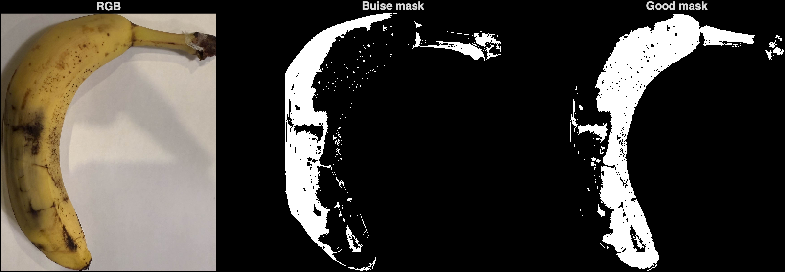

**Role:** Co-Author · **Team:** 3 · **Timeline:** Nov – Dec 2025

**Tools:** MATLAB, Image Processing Toolbox, Color Thresholder, k-nearest neighbors

## Overview

I co-developed a MATLAB computer vision pipeline that looks at a photo of a banana and decides
whether it's OK or bruised. It segments the peel into healthy and bruised pixels by color, then
classifies the banana with a k-nearest-neighbors vote against labeled examples. It was our final
project for ECET 369 at Purdue, applying vision methods to an automated inspection problem.

## What I did

- Segmented the banana from the background with an HSV saturation threshold, then cleaned the mask
  (`bwareaopen`, `imfill`, `bwareafilt`) and cropped to its bounding box
- Tuned color thresholds in MATLAB's Color Thresholder app to separate bruised peel from healthy peel
- Turned each banana into two features, its healthy-pixel and bruised-pixel counts, and classified
  it with a 3-nearest-neighbors vote
- Measured accuracy on held-out test images and on the training set with leave-one-out

## Challenges

Our biggest problem came from the data itself: the shadows the bananas cast in our photos. Standard
color thresholding picked up those shadows, and shaded areas of healthy peel, as bruised regions.
Rather than relying on a single bruise threshold to make the call, we used a k-nearest-neighbors
classifier that compares each banana's pixel counts against labeled good and bruised examples, so
shadow that shows up in every photo has less effect on the result.

## Results

On 10 photos (6 for training, 4 for testing):

- **Test set:** 3 of 4 correct (75%)
- **Training set, leave-one-out:** 3 of 6 correct (50%)

The classifier recognizes good bananas reliably but tends to miss bruised ones. The biggest next
steps would be a bruise threshold that ignores shadows, using the bruised *fraction* of the peel
instead of raw pixel counts so image scale doesn't matter, and a larger dataset.

## Links

- [Code, images and README (GitHub)](https://github.com/dillp1/banana-bruise-detection)
