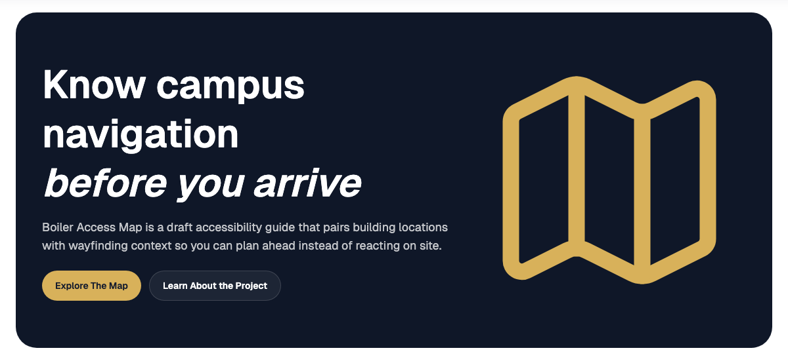

**Role:** Designer and developer · **Team:** Solo · **Timeline:** Mar – Apr 2026

**Tools:** React, TypeScript, Vite, Tailwind CSS, shadcn/ui, Google Maps JavaScript API, GitHub Pages

## Overview

Boiler Access Map is an accessibility guide to Purdue's campus. It puts building entrances on an
interactive map, along with the context you need to plan a route before you arrive instead of finding
out on site. I built it as my final project for HONR 460: Technological Justice, and it also serves as
my Honors College scholarly project.

Knowing which entrances are accessible can shape real decisions, like where a student chooses to live
or how they get from one class to the next. The site is a working draft, built in about two months,
meant as a starting point for disability advocacy at Purdue and other campuses.

## What I did

- Designed and built the entire site in React and TypeScript, from the data model to the UI
- Mapped 19 entrances across 5 campus buildings, tagging each with its access type (ADA button,
  ramp, stairs or standard), side of the building, visibility, and whether it's the main entrance
  or requires a detour
- Wrote a scoring system that rates each building's access experience on four levels: **Equal
  access**, **Accessible, but inconvenient**, **Technically accessible** and **Not accessible**
- Integrated the Google Maps JavaScript API so you can click an entrance marker to see its details
- Added keyboard-friendly search, a mobile layout, and a feedback survey for users
- Deployed it to GitHub Pages on its own domain

## Challenges

The core question was what "accessible" should actually mean. A building can have a ramp around the
back and still technically comply, but that isn't the same experience as walking in the front door.
So instead of a yes/no checkmark, the scoring looks at whether the accessible entrance is the main
entrance, how visible it is, and whether it requires a detour. A building only earns **Equal access**
when the accessible way in is also the main, visible one. Each building also prompts readers to think
about it themselves, with questions like *"If the accessible entrance is not the main entrance, is
this equal access?"*

## Results

- A live, mobile-friendly site at [boileraccessmap.org](https://boileraccessmap.org)
- 5 buildings and 19 entrances documented, each with an access-experience score
- A feedback survey built into the site to guide future versions

## Links

- [Live site: boileraccessmap.org](https://boileraccessmap.org)
- [Source code (GitHub)](https://github.com/dillp1/honr460-project)
