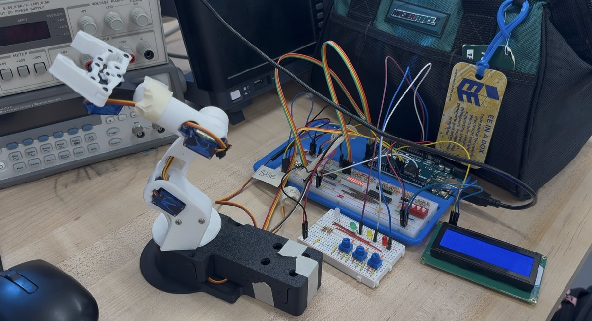

import demoVideo from './assets/desktop-robot-arm/demo.mp4';
import demoPoster from './assets/desktop-robot-arm/demo-poster.jpg';

**Role:** Designer and builder · **Team:** Solo · **Timeline:** Apr 2025

**Tools:** ATmega2560 (Arduino Mega), bare-metal C, Microchip Studio, MG996R servos, potentiometers, serial LCD

## Overview

I designed and built a three-servo desktop robot arm controlled by an ATmega2560 (Arduino Mega) as
an honors contract project for ECET 179, Purdue's intro to digital systems course. You pose the arm
with three potentiometers, save up to 10 points with a button, and it plays the sequence back on
repeat while an LCD shows what it's doing. The goal was to pull together everything from the course
into one system that works like a real manufacturing robot.

## What I did

- Generated 50 Hz servo PWM directly in hardware: Timer 3 in Fast PWM mode drives all three servos
  from its three compare channels, with pulse widths calibrated by testing the servos by hand
- Read the three potentiometers through the 10-bit ADC and mapped each reading to a joint angle for
  live manual control
- Wrote a record / playback / reset state machine that stores up to 10 poses and loops through them,
  and can be reset mid-playback
- Drove a serial LCD over UART to show the current mode and which point is being recorded or played
- Wrote everything with direct register access, with no Arduino libraries

## Challenges

I set myself the challenge of using every tool and workflow from my embedded systems lab and
lecture, and combining them into one system that mirrored real-world functionality rather than a
set of separate exercises. That led to the two features that make the arm feel like an industrial
robot: an LCD for operator feedback, and point recording and playback, the same teach-and-repeat
approach used to program robots in manufacturing.

## Results

A working arm that can be posed by hand, taught a sequence of up to 10 points and play it back on
repeat, with all of the control code running as bare-metal C on the microcontroller.

<figure className="video-figure">
  <video className="video" src={demoVideo} poster={demoPoster} autoPlay loop muted playsInline controls />
  <figcaption>Recording points in record mode, with the LCD confirming each one.</figcaption>
</figure>

## Links

- [Firmware, wiring and README (GitHub)](https://github.com/dillp1/desktop-robot-arm)
