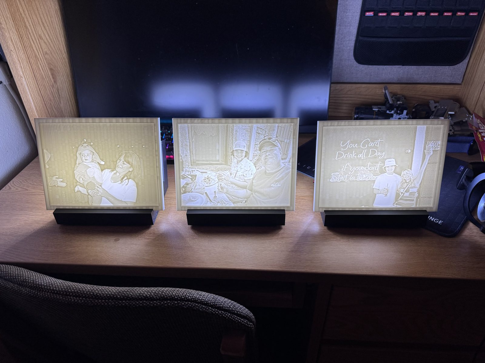
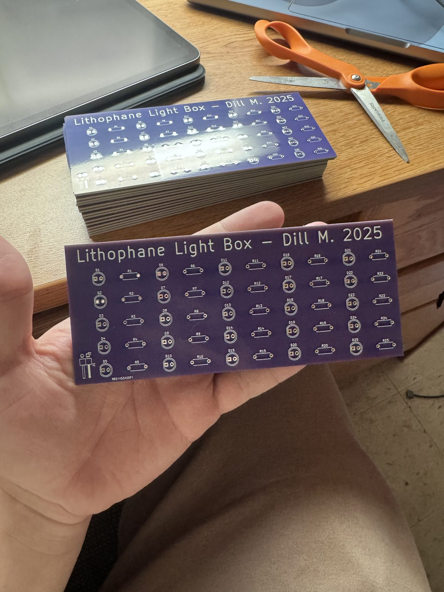

**Role:** Designer and builder · **Team:** Solo · **Timeline:** Dec 2025

**Tools:** KiCad, soldering, 3D printing

## Overview

A lithophane is a thin 3D print that shows a photo when it's lit from behind: thicker areas block
more light and print as shadows. I designed and built battery-powered light boxes to display them as
handmade holiday gifts for friends, from the circuit board to the finished enclosure.

## What I did

- Designed a custom PCB in KiCad
- Hand-soldered every component onto the board
- Designed and 3D printed a base that houses the PCB, battery pack and switch

## Challenges

Because these were gifts, I wanted a board I could assemble by hand without it feeling any less
handmade, and it all had to be finished before the holidays. That meant choosing components that were
easy to source and practical to solder by hand. It also meant learning how to account for component
footprints when laying out a PCB, which none of my coursework had covered. I researched commonly used
parts and designed around them, and on a tight deadline with no room for a second board revision,
everything from the component orders to the fabricated PCBs worked on the first try.

## Results

- Handmade holiday gifts for friends
- A first PCB designed, ordered and assembled entirely on my own

## Links

- [KiCad project and fabrication files (GitHub)](https://github.com/dillp1/lithophane-light-box)
