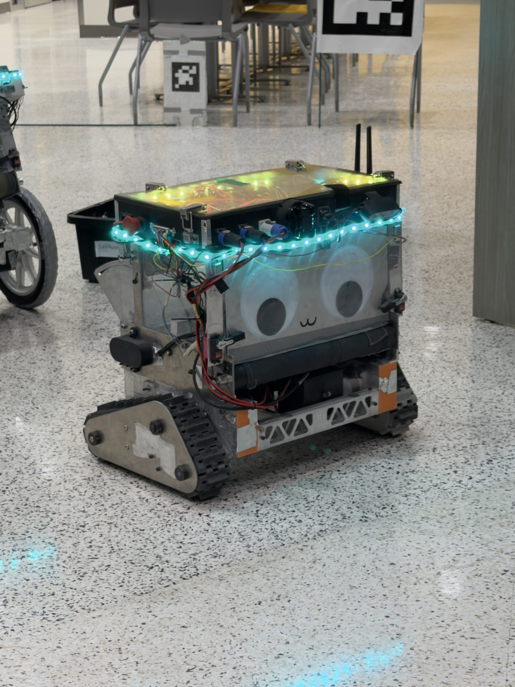

**Role:** Drivetrain Subteam Member · **Team:** Purdue Lunabotics (150 members) · **Timeline:** Aug 2025 – May 2026

**Tools:** SolidWorks, 3D printing, metal fabrication, PAHT-CF

## Overview

Purdue Lunabotics builds a lunar excavation robot for NASA's Lunabotics Challenge, where robots have to
drive and dig in simulated lunar regolith. On the drivetrain subteam, I took the robot's tread drivetrain
from design through to assembly on the competition robot.

## What I did

- Designed and modeled the full drivetrain in SolidWorks: wheels, gearboxes, treads and tensioners
- 3D printed all 52 tread pieces in PAHT-CF, a carbon-fiber-filled nylon
- Manufactured the remaining drivetrain components
- Assembled the complete drivetrain on the competition robot

## Challenges

Regolith dust is one of the hardest parts of the Lunabotics Challenge: it gets into every moving part.
A tread system is especially exposed, so instead of trying to keep dust out, we designed the drivetrain
on the assumption that it would always be full of grit. That drove our choice of PAHT-CF for the tread
pieces, which gives them the stiffness and wear resistance to keep running under constant abrasive friction.

## Results

At the 2026 NASA Lunabotics Challenge, the team placed:

- 4th for the Caterpillar Autonomy Award
- 12th in Systems Engineering

## Links

- [Competition video (YouTube)](https://www.youtube.com/watch?v=AZ1lYFaisfM)
- [NASA: 2026 Lunabotics winning student teams](https://www.nasa.gov/centers-and-facilities/kennedy/nasas-2026-lunabotics-winning-student-teams-engineering-lunar-future/)
