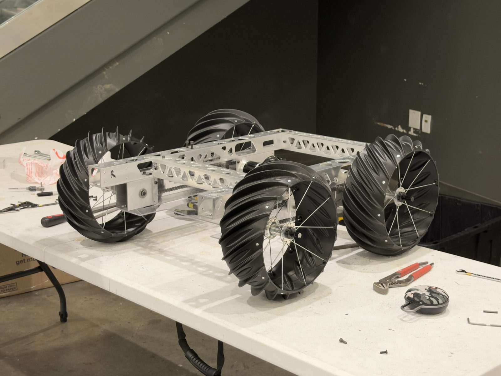

import waterjet from "./assets/lunabotics-fabrication-lead/waterjet.jpeg";
import machinedPart from "./assets/lunabotics-fabrication-lead/machined-part.jpeg";
import RailStats from '@site/src/components/RailStats';

**Role:** Fabrication Operations Team Lead · **Team:** Purdue Lunabotics (150 members) · **Timeline:** May 2026 – present

**Tools:** SolidWorks, 3D printing, metal fabrication, Google Sheets, Google Apps Script

## Overview

After designing the robot's drivetrain as a member of the drivetrain subteam
([see that project](./lunabotics-drivetrain)), I moved into leading fabrication for Purdue Lunabotics.
I lead the club's mechanical members through building the robot, and I'm responsible for making sure
parts get designed so they can actually be made, get made on schedule, and get tested safely.

## What I do

- Lead the mechanical members of a 150-member club through manufacturing the competition robot
- Coordinate manufacturing across the team and track part timelines so builds stay on schedule
- Review CAD for manufacturability before parts go to fabrication
- Own the team's workspace and testing-pit operations
- Built and rolled out the team's **RAIL** (Rolling Action Item List), a shared Google Sheet with custom Apps Script tooling for tracking fabrication work

  <figure>
    
    <figcaption>Cutting aluminum plate on the waterjet.</figcaption>
  </figure>
  <figure>
    
    <figcaption>A finished machined aluminum part.</figcaption>
  </figure>

### The RAIL

The RAIL is a shared Google Sheet I built to keep fabrication organized. It brings together:

- **Part tracking:** where every part is, from design through fabrication
- **3D print optimization:** planning prints to make better use of printer time and material
- **Member assignments:** who is working on what
- **Stock tracking:** what raw material we have on hand
- **A custom FabOps menu:** tools I wrote in Google Apps Script, built into the sheet's menu bar

It's built so subteam leads can see the progress of their subsystem at a glance, while general
members can see the work assigned to them and what's open for anyone to pick up.

<RailStats />

<figure className="video-figure">
  
  <figcaption>The RAIL: every part's status, subteam, subassembly and the machine it needs, with a tab per subteam.</figcaption>
</figure>

## Challenges

The hardest part of the role has been creating new workflows like the RAIL and getting a whole club
to actually use them. That's harder because we share our workspace and resources with our sister
club, Purdue Boiler Robotics, so any process has to work for both teams. Instead of handing down a
finished system, I've built it around feedback from general members, subteam leads and the sister
club, so fabrication runs more smoothly across both clubs and the shared space.

## Results

The robot this team is building competes at the next NASA Lunabotics Challenge. Results to come.
