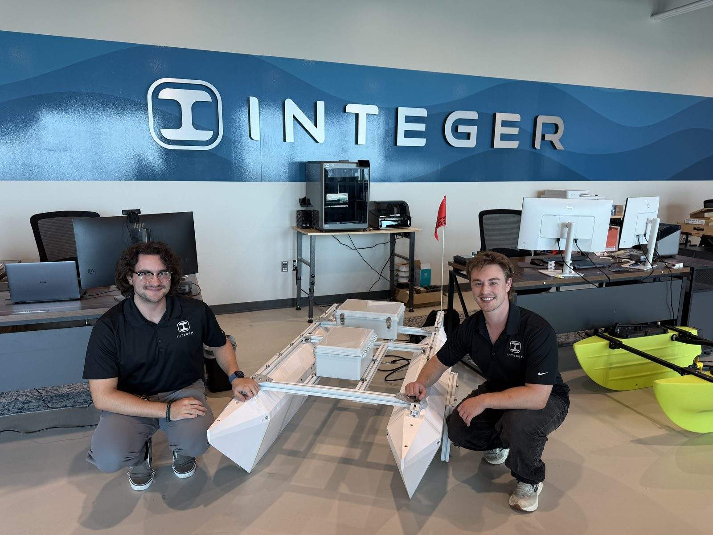

**Role:** Robotics Engineering Intern, Integer Technologies · **Team:** 3 engineers · **Timeline:** May 2026 – Aug 2026

**Tools:** ArduPilot, BlueOS, QGroundControl, 3D printing, Fabrication

## Overview

During my internship at Integer Technologies, I co-engineered a
differential-drive unmanned surface vessel (USV) for the company's $9.8M
ONR-funded seabed-warfare program. We validated the platform for both manual
and autonomous control missions with ArduPilot and QGroundControl.

## What I did

- Co-engineered a differential-drive USV, validated for both manual and
  autonomous control missions with ArduPilot and QGroundControl
- Led 3D print operations, totaling 755 hours with a 92% print success rate
- Led 3 in-water validation tests with 0 safety incidents

## Challenges

This was my first time working with robotics in aquatic applications. One issue we ran into was ensuring that the vessel was able to withstand the buoyancy forces of the hulls. We discovered this during our first float test, where the two hulls hinged at the frame and bowed outwards. This was fixed by looking back at the design, and finding where we were able to constrain that force and rotational movement with metal T brackets along the extruded material.

## Results

- Platform validated for both manual and autonomous control missions
- 3 in-water validation tests completed with 0 safety incidents
- Modular design for easy implementation and installations of sensors for data collection

## Links

- [News coverage: Southern Miss and Integer Technologies awarded $9.8M Navy seabed warfare program (WLOX)](https://www.wlox.com/video/2026/08/06/southern-miss-integer-technologies-awarded-98m-navy-seabed-warfare-program/)
